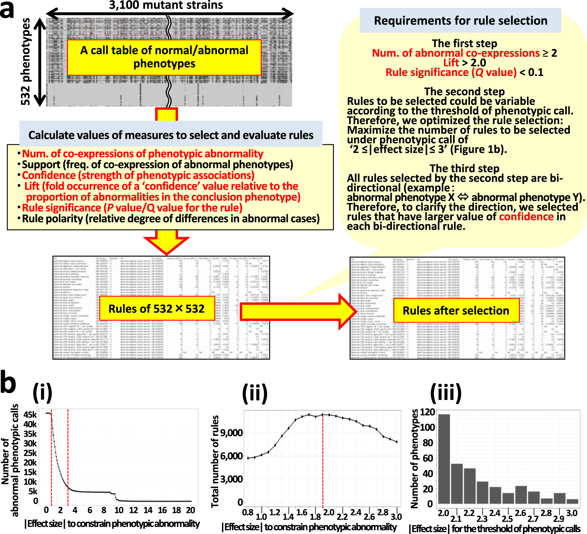
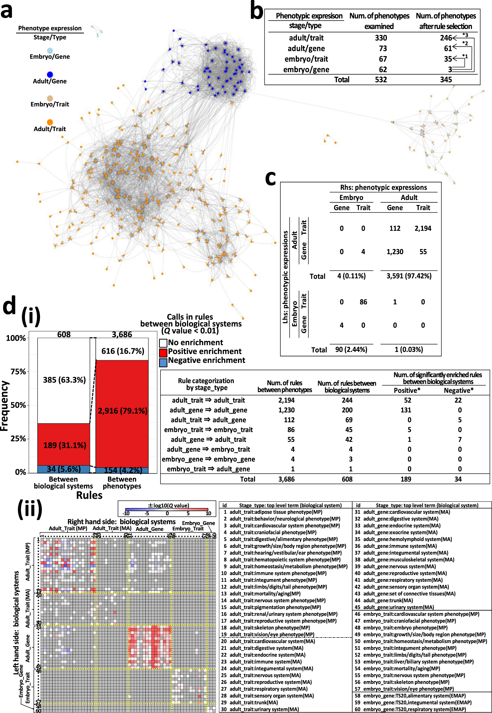
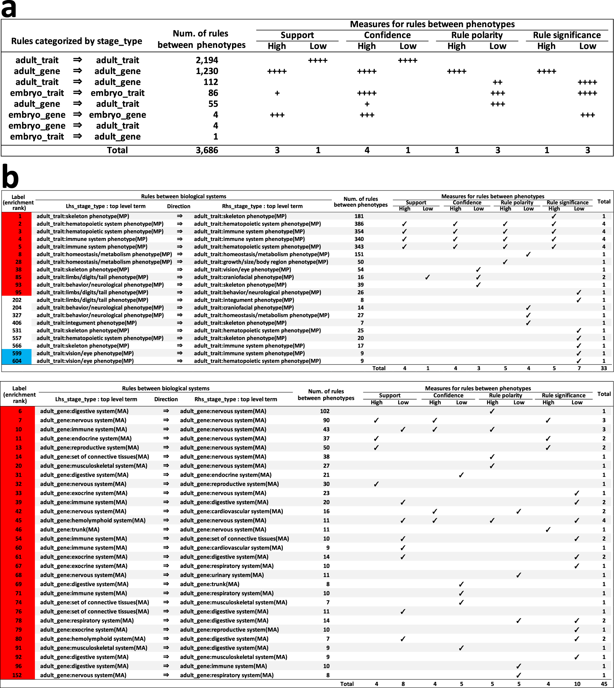
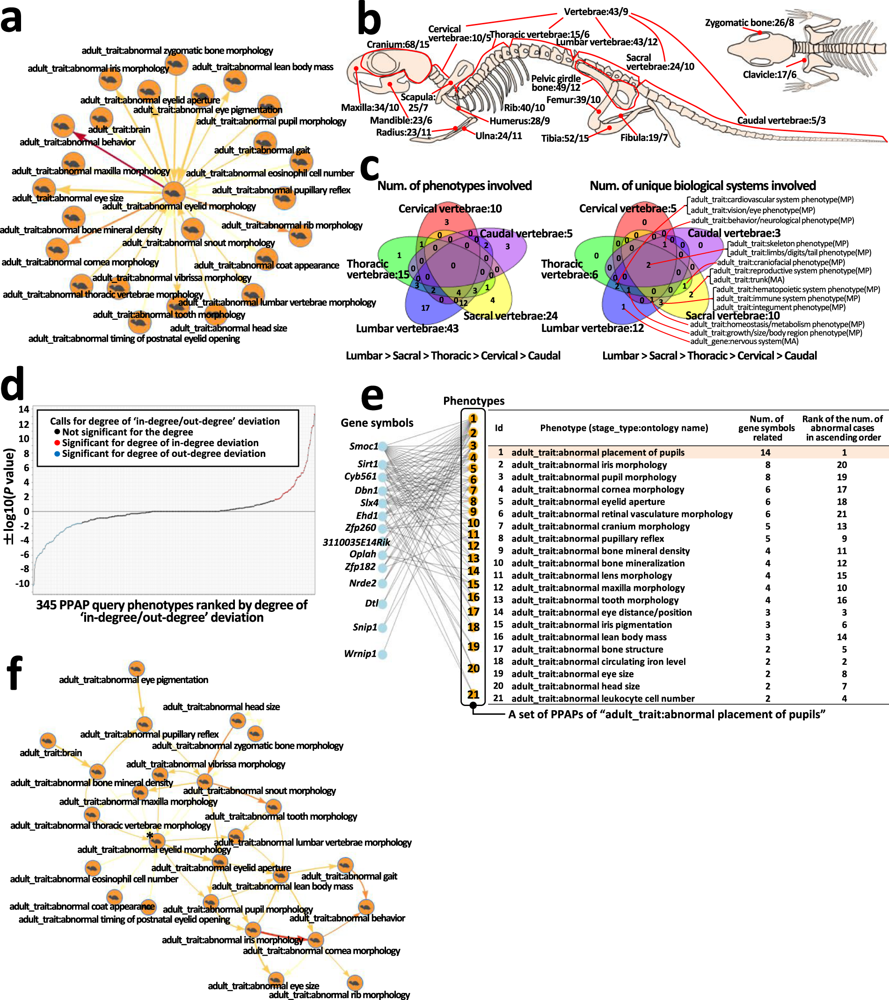
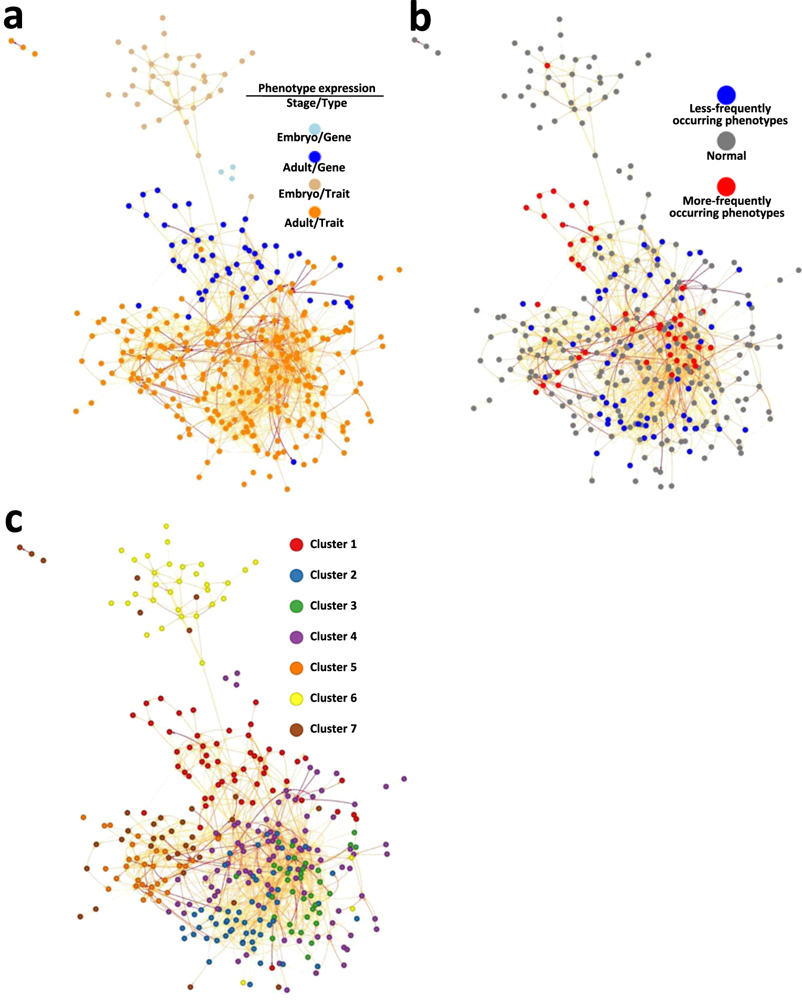
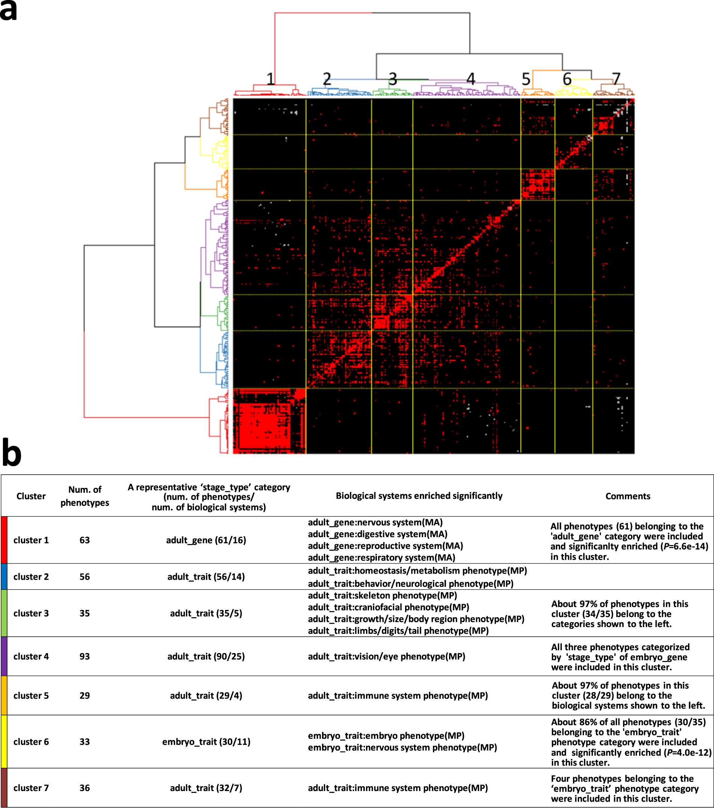
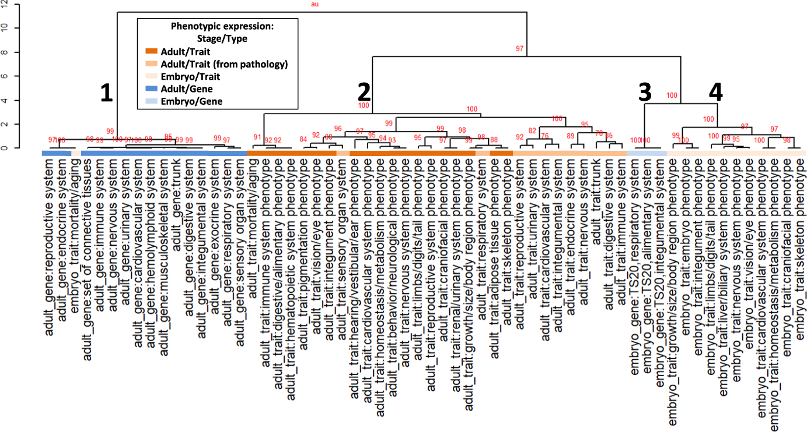

## 論文情報

**An atlas of evidence-based phenotypic associations across the mouse phenome**  
Nobuhiko Tanaka, Hiroshi Masuya  
*Scientific Reports*, 10, 3957 (2020)  
[論文ページ（DOI: 10.1038/s41598-020-60891-w）](https://www.nature.com/articles/s41598-020-60891-w)

掲載したFig. 1〜7はTanaka・Masuya（2020）から改変せずに転載した。[CC BY 4.0](https://creativecommons.org/licenses/by/4.0/)

---

## 背景と目的

あるノックアウトマウス系統で除脂肪体重に異常が見つかったとき、ほかにどのような異常が一緒に現れやすいだろうか。多数の遺伝子を個別に欠損させ、共通の手順で表現型を測定したデータがあれば、異常が同じ系統に現れる頻度を調べられる。

著者らは国際マウス表現型コンソーシアム（IMPC）のデータを使い、**同じノックアウト系統で組み合わせとして現れやすい表現型異常**を抽出した。さらに、一つの表現型を起点に関連する異常をまとめ、**表現型モジュール**として整理した。

## 手法

### 一緒に現れやすい異常を選ぶ（Fig. 1）

IMPC Release 4.3の3,100ノックアウト系統を対象とした。2,050の測定項目を、表現型や解剖学の用語と発生段階・検査の種別に基づいて532の表現型に整理した。例えば、脂肪量と体重に占める脂肪量の割合は、ともに「脂肪組織量の異常」にまとめた。

表現型のペアごとに、**両方の検査結果がある系統**を集めた。例えば「脂肪組織量の異常」と「血糖値の異常」を調べる場合、脂肪量の検査だけを受けた系統は、その組み合わせの集計から外れる。

| 指標 | 何を数えるか |
| --- | --- |
| 同時異常の系統数 | 両方の検査結果がある系統のうち、脂肪組織量と血糖値が両方とも異常だった系統数 |
| 信頼度 | 脂肪組織量が異常だった系統のうち、血糖値も異常だった割合 |
| リフト | 上の信頼度を、両方の検査結果がある全系統での血糖値の異常割合で割った値 |

リフトが1なら、脂肪組織量が異常な系統と集計対象全体で、血糖値の異常割合は同じである。著者らは**同時異常が2系統以上、リフトが2より大きく、両側Fisherの正確確率検定を多重検定補正したQ値が0.1未満**の関連を候補とした。

異常判定には、対照群との違いの大きさを示す効果量（Hedgesのg）を使った。有意性の条件も課したうえで、最終的には効果量の絶対値が2.0〜3.0の範囲で、抽出される関連が最も多くなる閾値を表現型ごとに選んだ。同じペアの二方向を比較し、信頼度の高い方向を採用した。

:::note
二方向の信頼度は、分子が同じ「両方とも異常だった系統数」で、分母はそれぞれ起点の表現型が異常だった系統数である。そのため、図の矢印は、両方を検査した系統の中で異常例が少ない側から多い側に向く。矢印から因果関係や発症順序を判断するには、別の実験や時系列データが必要になる。
:::

---

## 結果

### 345表現型をつなぐ3,686件の関連（Fig. 2）

抽出された**3,686件の関連**には、345の表現型と60の生物学的システムが含まれた。ここでいう生物学的システムは、造血系や免疫系など、個々の表現型をまとめた上位区分である。関連の97.4%（3,591件）は成体の表現型同士だった。Fig. 2dでは、異なる生物学的システムの組み合わせごとに、抽出された関連が期待より多いか少ないかを示している。

### 関連の特徴は一つの指標では捉えきれない（Fig. 3）

著者らは、同時異常の割合、信頼度、矢印の向きによる信頼度の差を評価する指標、関連の統計的な有意性を比較した。成体の形質検査同士では、同時異常の割合や信頼度が低い関連が多かった。一方、成体の遺伝子発現に関する項目同士では、四つの指標が高い側に偏っていた。**起点の異常があるときに相手の異常がどれくらい現れるか**と、**その関連を支持する統計的な証拠の強さ**は、それぞれ別の問いに答える。

### 一つの異常を起点に表現型モジュールを作る（Fig. 4）

この論文で特に面白いのは、関連を一組ずつ眺める代わりに、**一つの表現型の周りにどのような異常が集まるか**を調べた点である。著者らは、起点の表現型とそれに関連する表現型の組をまとめ、PPAP（表現型間の関連ペア）の集合と呼んだ。345の表現型それぞれを起点にモジュールを作成した。

- **Fig. 4a**では、「眼瞼形態の異常」を中央に置き、関連する異常を周囲に並べている。線が太いほど信頼度が高い。
- **Fig. 4b、c**では、骨格の部位によって関連する異常の広がりがどう異なるかを比較した。脊柱の5部位では、関連する表現型数と生物学的システム数がともに、腰椎、仙椎、胸椎、頸椎、尾椎の順に多かった。
- **Fig. 4d**では、矢印の出入りから、関連する異常と比べて異常例が相対的に少ない表現型を60、多い表現型を49見つけた。
- **Fig. 4e**では、「瞳孔位置の異常」のモジュールと異常が多く重なるノックアウト系統を順位付けした。**Fig. 4f**では、眼瞼形態の異常を起点とするモジュールを、矢印をたどれる経路状に並べ直した。

例えば、「除脂肪体重の異常」を起点とするモジュールでは、17の生物学的システムにまたがる82の異常表現型が得られた。この82はモジュールに含まれる表現型の数である。各ペアの関連はそれぞれの検査結果から求めているため、同じ系統にどの異常がいくつ重なるかは、系統ごとの測定結果を見て判断する。

### モジュール内の関連をつないで全体像を描く（Fig. 5）

345モジュールのうち、経路状に整理できた283モジュールを統合すると、335表現型と1,543件の関連で構成されるネットワークが得られた。Fig. 5では、発生段階と検査の種別、異常例の相対的な多さ、Fig. 6のクラスターという三つの観点から同じネットワークを色分けしている。複数の矢印をたどることで、直接の関連が抽出されていない表現型同士についても、追加検証する組み合わせを考えられる。

### モジュールを構成する表現型の重なりから7群を見つける（Fig. 6）

345のモジュールを、関連する表現型の顔ぶれが似ているもの同士でまとめると、七つのクラスターが得られた。Fig. 4が一つの異常を起点にした地図だとすると、Fig. 6は、その地図を並べて**どの起点が似た関連パターンを持つか**を見た図である。ヒートマップでは灰色で未検査の組み合わせが示されており、検査の範囲も確認できる。

### 生物学的システムのまとまりを調べる（Fig. 7）

今度は個別の表現型を生物学的システムに置き換え、345モジュールを通じて似た現れ方をするシステムをまとめた。60の生物学的システムは、成体・胚と形質検査・遺伝子発現の組み合わせに対応する四つの群に分かれた。Fig. 6の七群は**表現型モジュール**を、Fig. 7の四群は**生物学的システム**を分類した結果である。

---

## まとめ

本研究は、IMPCのノックアウトマウスデータから、一緒に現れやすい異常を3,686件抽出し、**着目した異常にどのような異常が伴いやすいか**を表現型モジュールとして調べられるようにした。モジュールに含まれる異常と各系統の異常を照合すれば、複数の形質に影響する遺伝子の候補も探せる。

結果が捉えているのは、IMPC Release 4.3の3,100系統で、対象の検査が行われた範囲での関連である。また、異常判定には効果量の絶対値を用いるため、例えば測定値の上昇と低下が、同じ表現型の異常として集計されうる。具体的な病態を検討する際は、元の測定項目と変化の方向を確認する必要がある。

原著では個別の表現型や生物学的システムの関連を閲覧するためのアプリも紹介されている。[表現型間の関連](https://brc-riken.shinyapps.io/phenotypic_associations_across_the_mouse_phenome/)・[生物学的システム間の関連](https://brc-riken.shinyapps.io/associations_between_biological_systems/)
